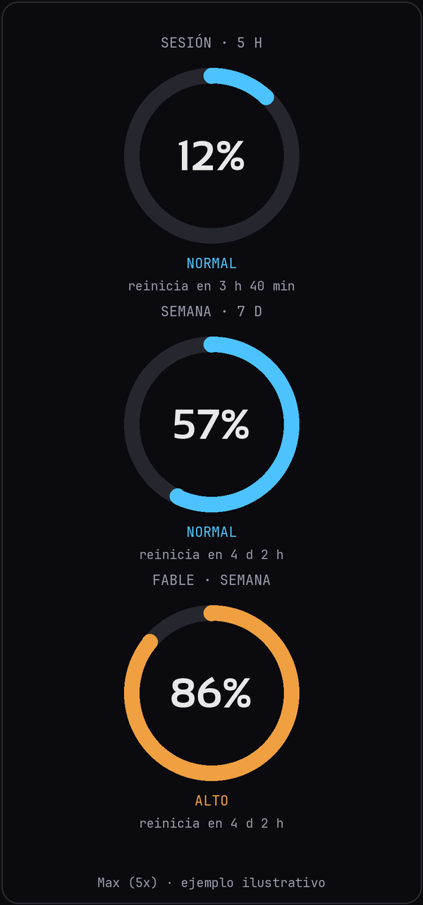

# claude-usage-widget

*Imagen ilustrativa con datos de ejemplo, no es una captura real.*

Widget de escritorio para Windows (Python + tkinter) que muestra tu uso de Claude con gauges circulares antialiased y estilo Motita (tema oscuro).

## Qué muestra
- Sesión (5 h), semana (7 d) y Fable semanal, con el % real del plan y el tiempo hasta el reinicio.
- Si no hay datos reales, estima el uso desde los logs locales de Claude Code frente a tu pico de 30 días.

## Instalación
1. Python 3.9+ para Windows.
2. Instala Claude Code e inicia sesión una vez (`claude`).
3. Ejecuta `claude_usage_widget.bat`.

## Cómo obtiene el % real (en orden)
1. **Token de Claude Code** (`~/.claude/.credentials.json`) → `api.anthropic.com/api/oauth/usage`. Endpoint no documentado oficialmente: puede cambiar o responder 429. El token solo se lee; no se refresca ni se copia.
2. **Ventana WebView2** (`pip install pywebview`) con tu propia sesión de claude.ai, si no hay token.
3. **Statusline de Claude Code** (`claude_usage_statusline.py`) para los límites de 5 h y 7 d.

Los datos se guardan en `%APPDATA%\claude-usage-widget-motita`.

## Fuentes
Incluye Sansation y JetBrains Mono Nerd Font (SIL OFL 1.1) en `claude_usage_widget_fonts/`; ver `NOTICE.md` y `OFL.txt`.

## Aviso
Proyecto no oficial, sin relación con Anthropic. Úsalo bajo tu responsabilidad.

## Licencia
MIT (ver `LICENSE`). Las fuentes mantienen su propia licencia OFL.
